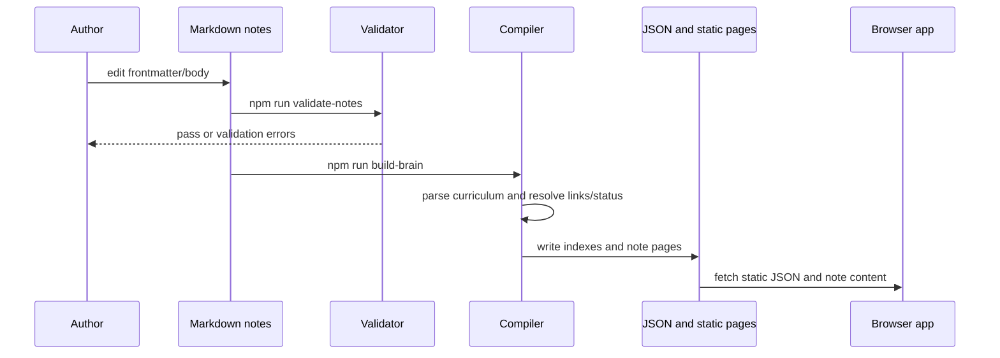

# VIZIER — Project Blueprint

This guide describes the implementation in this repository as checked in. The project is named `ai-knowledge-graph` on GitHub and calls its curriculum application **VIZIER**. The repository contains more than the browser app: its central deliverable is a static AI-engineering learning map, while adjacent `brain/` scripts and documents represent a broader personal knowledge/assistant concept and tooling experiments.

## Contents

- [Purpose and audience](#purpose-and-audience)
- [Current state and maturity](#current-state-and-maturity)
- [User experience](#user-experience)
- [Architecture](#architecture)
- [Data model and processing](#data-model-and-processing)
- [Important algorithms](#important-algorithms)
- [Repository map](#repository-map)
- [Setup and troubleshooting](#setup-and-troubleshooting)
- [Privacy and security boundaries](#privacy-and-security-boundaries)
- [Limitations and extension paths](#limitations-and-extension-paths)
- [Source reference](#source-reference)

## Purpose and audience

VIZIER organizes an individual’s AI-engineering study into a graph-shaped curriculum. Its intended learner can move from foundational concepts through implementation exercises and capstones, record notes as Markdown, and navigate dependencies and cross-links spatially. The graph visualizes relationships already present in the syllabus and notes; it does not infer a knowledge graph from arbitrary documents or answer questions with an AI model.

The curriculum’s ten domains are foundations; prompting and APIs; RAG and retrieval; agents; multi-agent systems and MCP; memory and knowledge; evaluation and observability; safety and security; production; and frontier/capstone work. Node records include an ID, title, domain, chapter/sequence, cluster, type, effort size, summary, prerequisite IDs, status, dates, and backlinks. The curriculum source is [the mastery graph](curriculum/VIZIER_MASTERY_GRAPH.md); authored content lives under [notes/](notes/).

## Current state and maturity

The checked-in public index has 244 total graph records: 228 curriculum records, 10 domain records, one center record, and five milestone records. It contains 1,515 edges. Its metadata reports 0 lit and 228 charging curriculum items, 0 XP, and a current/best streak of 1. These are values baked into the committed artifact, whose `generated_at` is 2026-07-21; they are not live usage analytics. The build pipeline recalculates artifacts when run.

The implementation has meaningful product depth: a static graph/library interface, note-reading flow, curriculum compiler, validator, and daily note-authoring utilities. Its maturity is mixed:

| Area | Evidence-based status |
|---|---|
| Static browser application | Implemented in `site/`, backed by generated graph JSON and static notes. |
| Curriculum and authored content | Extensive, with 228 planned/active entries and corresponding Markdown notes in the checked-in dataset. |
| Completion/motivation model | Status, XP, streak, and badges are calculated/displayed from generated data. The committed snapshot has no completed curriculum nodes. |
| Browser-side persistence | No curriculum completion writes are implemented in the UI. `localStorage` is used for capstone celebration IDs, not as a progress database. |
| Account-backed product | No login, user database, or user sync is part of this static app. |
| Deployment | `vercel.json` configures `site/` as output, but this review did not verify a live deployment. |
| Adjacent integrations | Some scripts and documents reference Supabase, OAuth, MCP, an agent, or an API. They are separate tools/proposals, and their live operation is not established by the static UI. |

The README claims an “Empty-Lit Guard”; the source does enforce minimum substantive content for notes marked `lit`, and the validator also checks required curriculum/note alignment and metadata. However, the guard proves only a structural threshold (three non-heading/comment lines of at least 20 characters), not learning quality, factual correctness, or successful execution of a build artifact.

## User experience

### Graph view

The application fetches `brain-index.public.json`, then renders the graph. Users can zoom and pan, switch between concentric rings and a force-directed layout, adjust visual controls, search titles/domains/tags, and select a node to inspect its metadata, prerequisites, backlinks, and note preview. Query parameters `?note=<id>` or `?node=<id>` can open a matching record. The graph presentation is in [graph-engine.js](site/js/graph-engine.js), with shared data and state in [config.js](site/js/config.js) and entry-point wiring in [app.js](site/js/app.js).

### Library view

The library renders records from the same in-memory graph dataset. It supports search and filters for status, domain, type, ring, and effort size; sorting includes curriculum order, code, update date, revision count, ring, and alphabetical order. The “continue” card is selected from current node statuses and ordering; it does not persist an independent reading position. See [library-engine.js](site/js/library-engine.js).

### Note reader

Selecting a note opens an inspector panel. The reader fetches a static Markdown preview from `site/notes/<id>.md`, then converts content for display; generated standalone HTML pages are also emitted by the build. Wiki links in note content open other nodes, and the interface exposes a deep-link copy action and a standalone-page action. The implementation is in [note-reader.js](site/js/note-reader.js), and generated page rendering is in [build.js](tools/site-build/build.js).

The note renderer includes hand-written transformations for headings, lists, tables, inline code, wiki links, and code blocks. The browser also loads Marked from a CDN. Avoid treating every Markdown edge case as supported: the custom compiler/reader is not a full standards-conformant Markdown toolchain.

## Architecture

```mermaid
flowchart LR
  syllabus["curriculum/VIZIER_MASTERY_GRAPH.md"] --> compiler["tools/site-build/compile-curriculum.js"]
  notes["notes/**/*.md"] --> validator["tools/validate-notes.js"]
  notes --> compiler
  compiler --> indexes["site/brain-index.*.json"]
  compiler --> curriculum["curriculum/curriculum.json"]
  compiler --> pagegen["tools/site-build/build.js"]
  pagegen --> pages["site/notes/*.md and *.html"]
  pagegen --> app["site/index.html + assets"]
  indexes --> browser["VIZIER static SPA"]
  pages --> browser
  browser --> graph["D3 graph"]
  browser --> library["Searchable library"]
  browser --> reader["Note reader"]
```

The browser does not contain a backend service. Its graph and curriculum records are precompiled static data. `site/index.html` loads D3.js v7 and Marked from public CDNs, loads Highlight.js from local assets, and loads the local application scripts in sequence. The deployment configuration points Vercel at `site/` and declares `npm run build-brain` as the build command; that command first validates notes and then rebuilds artifacts.

### Data and state boundaries

| State | Source of truth | Runtime behavior |
|---|---|---|
| Curriculum structure | `curriculum/VIZIER_MASTERY_GRAPH.md` | Parsed by compiler; structured snapshot emitted to JSON. |
| Note status and content | Markdown in `notes/` | Frontmatter/content are validated and compiled into generated records/pages. |
| Graph edges | Curriculum prerequisites and `[[wikilinks]]`, plus other compiler-defined relationships | Stored as edge records in the generated JSON. |
| Browser selection, filters, layout | JavaScript memory | Resets on page reload. |
| XP, streak, status counts | Generated metadata and statuses | Read/displayed by the UI; not edited by the UI. |
| Celebration dismissal | Browser `localStorage` key `vizier_celebrated_capstones` | Prevents repeat capstone celebrations on that browser; unrelated to learning progress. |
| Optional Supabase counters in older/adjacent brain index tooling | Environment file searched by `brain/` tools | Not required by the VIZIER static site and not part of its displayed curriculum dataset. |

## Data model and processing

### Node and edge records

The generated public index is an object with `nodes`, `edges`, `stats`, and `metadata`. A simplified curriculum node looks like:

```json
{
  "id": "build-first-rag",
  "label": "Build: First RAG",
  "type": "build",
  "domain": "rag-retrieval",
  "ring": "rag-retrieval",
  "status": "charging",
  "size": "L",
  "requires": ["why-rag"],
  "path": "notes/03-rag-retrieval/03-05-build-first-rag.md"
}
```

Exact fields vary by record type. Structural center/domain nodes, curriculum nodes, milestones, and optional catalog entries share the node collection. Edges carry `source`, `target`, and a relationship `type`, such as prerequisite/sequence links or wiki links. On the browser side, D3 force-link layout expects IDs but may resolve endpoint IDs to node objects while simulating.

### Processing flow

1. **Author:** Add or edit a Markdown note. Frontmatter identifies its node and records metadata such as status, dates, version, and revisions.
2. **Validate:** `tools/validate-notes.js` compares note files with `curriculum/curriculum.json`, validates IDs, status/date/version fields, checks substantive content for lit notes, scans for private flags and secret-like patterns, and checks note links according to its implementation.
3. **Compile:** `compile-curriculum.js` parses the mastery graph and note frontmatter/content. It resolves status, constructs node records and prerequisite/domain/milestone relations, scans note bodies for `[[wikilinks]]`, builds backlinks/metadata, derives progress fields, and writes `curriculum/curriculum.json` plus the public and preview index files.
4. **Generate pages:** `tools/site-build/build.js` creates note Markdown/HTML outputs and related site assets from source notes.
5. **Browse:** `site/js/app.js` loads the public JSON; graph, library, reader, and gamification modules render UI from the resulting in-memory data.



### Worked link example

If note `why-rag` contains `[[build-first-rag]]`, the compiler extracts the text inside double brackets, resolves the target against known curriculum nodes, and emits a typed edge from `why-rag` to `build-first-rag`. The browser can then render that relationship and the note reader can navigate to the target. A malformed or unmatched target may remain plain content or fail to create an edge depending on the compiler path; the validator’s link checks should be run after editing.

## Important algorithms

### Curriculum compiler and link resolution

The compiler builds a node collection from the syllabus, notes, and supporting registries. It creates relationships from curriculum dependencies and scans note content for wiki links. An inverted keyword index is also derived for records with file paths. Full note bodies are removed from the graph records after edge construction to keep the graph index smaller; the reader retrieves note content separately as static Markdown.

### Progress calculation and lit validation

Statuses are represented as dark/ghost, charging/in-progress, and lit/learned variants in the source, with legacy synonyms handled by validation/compiler logic. XP is computed from lit records using effort-size weights, with capstones receiving a fixed award. Streak and level displays come from generated metadata and formulas in the UI. The `lit` guard is a content-length heuristic, not a semantic assessment. The mastery graph describes the intended “locked after lit” rule, and the compiler can write lock snapshots into `curriculum/.locked/`; the existence of a design rule should not be confused with a proof of immutable or quality-verified mastery in the UI.

### Graph layout

The graph engine uses D3 force simulation with link, charge, centering, and collision forces. A separate ring layout arranges concepts by curriculum domain; the interface can stop force simulation for ring mode and switch modes interactively. SVG handles the interactive graph structure and labels; a canvas is prepared for dense graph rendering when the graph exceeds 1,500 nodes. The current checked-in graph has 244 records, so the “large graph canvas” branch is a scale path, not evidence of current 1,500+ record performance.

### Library filtering and sorting

The library applies current search and filter values over the loaded node collection, then sorts the remaining array by the selected field. Counts and progress bars derive from the filtered and overall sets. This is client-side filtering over a small preloaded dataset, not a server query or ranked semantic search.

## Repository map

| Path | Responsibility |
|---|---|
| `curriculum/VIZIER_MASTERY_GRAPH.md` | Human-authored curriculum graph and milestones. |
| `curriculum/curriculum.json` | Generated structured curriculum snapshot used by the validator and other tooling. |
| `curriculum/CHANGELOG.md`, `curriculum/UNIVERSES.md` | Curriculum history and planning. |
| `notes/<domain>/*.md` | Learning notes and frontmatter used by build/validation. |
| `brain/knowledge/`, `brain/taxonomy.yaml`, registries | Adjacent knowledge-base/content organization and indexed metadata. |
| `tools/validate-notes.js` | Note/curriculum validation and safety-pattern checks. |
| `tools/site-build/compile-curriculum.js` | Curriculum compiler and graph/index generation. |
| `tools/site-build/build.js` | Static note page/site asset generation. |
| `tools/sync-note.js` | Note metadata/build/Git workflow helper. |
| `site/index.html`, `site/js/` | Browser application shell and feature modules. |
| `site/brain-index.public.json` | Committed public graph dataset consumed by the app. |
| `site/notes/` | Generated note Markdown and standalone HTML pages. |
| `source-volumes/`, `docs/`, `notes/` | Long-form curriculum references, product/spec notes, and work records. These include plans and historical material as well as implementation details. |
| `brain/server.js`, `brain/scan.js`, `tools/ingest_pipeline.js` | Separate/legacy brain indexing and server utilities; not the static app backend. |

Earlier project notes and reports contain plans and claims about integrations, deployment results, and guarantees that are not all supported by the checked-in implementation. This blueprint is the current source-grounded orientation; those historical source documents are retained.

## Setup and troubleshooting

### Requirements

- Node.js for the validation and build scripts.
- A browser and network access to load D3.js and Marked from their CDNs.
- A local HTTP server for the app, because it fetches JSON and Markdown files. Direct `file://` opening is not a reliable run mode.

There are no declared `dependencies` or `devDependencies` in [package.json](package.json). No `npm install` is needed for the checked-in scripts. The `serve` script invokes `npx -y http-server`, which may download its server tool on first use.

### Commands

```bash
# Check curriculum/note consistency and guards
npm run validate-notes

# Validate, then rebuild generated JSON and static pages
npm run build-brain

# Serve the existing site at http://localhost:8080
npm run serve
```

Alternative if Python is already installed:

```bash
python -m http.server 8080 --directory site
```

For source changes, check the script itself before running `npm run sync` or `npm run light`. `tools/sync-note.js` can update note frontmatter, run the build, stage **all** repository changes, commit, and push directly to `main`. The `light` command forces a note to lit. These are consequential authoring operations, not preview commands.

### Common issues

| Symptom | Likely cause and next check |
|---|---|
| Graph/library remains empty | Serve over HTTP and check browser console/network for `brain-index.public.json` or CDN failures. |
| Note preview fails to load | Check the matching ID and generated `site/notes/<id>.md` path; rebuild after source-note changes. |
| `validate-notes` fails on mapping | Confirm the curriculum record has exactly one note and frontmatter ID matches the note path/expected identifier. |
| A lit note fails validation/build | Add at least three substantive non-heading/comment lines of 20+ characters each, or set its status to charging until complete. |
| `npm run serve` cannot start | `npx` may need network access to fetch `http-server`; use an already installed static HTTP server. |
| A new wiki link is missing from graph | Check target spelling/ID resolution, then run validation and rebuild the generated index. |

This review did not install packages or run the application build; the commands above are read from project configuration and source.

## Privacy and security boundaries

The static app displays repository content published under `site/`. It has no login or authorization layer and should be treated as public content. The validator and build verifier use pattern-based checks for credentials, contact information, local paths, and other private markers; such pattern scans can miss secrets and can produce false positives. Do not put secrets or private notes in public source files.

Some separate scripts inspect local environment files or talk to Supabase when credentials are available. The static UI does not need these credentials. This review neither accessed nor queried any external database. Treat old notes about OAuth, agent actions, or integrations as plans/research unless corresponding runnable code and configuration establish otherwise.

## Limitations and extension paths

### Current limitations

- Progress is a committed content state, not multi-user or live browser state. Updating it means changing source note metadata and rebuilding/publishing artifacts.
- The checked-in dataset has no curriculum node marked complete; XP/streak and trophies therefore must not be presented as validated learner outcomes.
- D3 and Marked are external runtime dependencies loaded from CDNs, so the app is not fully offline despite static output and a bundled syntax-highlighting asset.
- Custom Markdown conversion has a constrained feature set; rendering arbitrary untrusted Markdown deserves security review before accepting user-supplied content.
- Status validation uses simple frontmatter parsing and content heuristics, not a full YAML parser or semantic review.
- The compiler contains optional/adjacent integrations and data models beyond what the static app renders; documentation and UI can drift as the curriculum changes.
- Repository claims about Vercel deployment, performance, production readiness, broad browser support, and exact feature behavior are not independently verified here.

### Realistic extensions

1. Add a small fixture-based compiler test suite for IDs, aliases, status transitions, wiki-link resolution, backlinks, malformed frontmatter, and empty-lit cases.
2. Pin or bundle D3 and Marked locally; then verify the app with network disabled to substantiate offline support.
3. Harden the Markdown renderer with a maintained sanitizer and explicit allowlist; add tests for raw HTML and link protocols.
4. Add accessibility checks for graph alternatives, keyboard navigation, focus management, and reduced-motion behavior.
5. Track completion in a deliberate persistence layer only if multi-device or multiple-learner use becomes a product requirement; retain clear privacy boundaries.
6. Add curriculum versioning and generated-artifact freshness checks so the source, JSON, and rendered pages cannot silently diverge.

The graph-plus-curriculum pattern could transfer to **Trelis Student** as a visual map of learning goals, prerequisites, evidence/artifacts, and reflection notes. Keep the transferable parts (typed nodes, explicit prerequisite edges, status semantics, and generated views) while adapting the domain model and privacy rules to students; do not import VIZIER’s personal-assistant integrations or assume XP is a good educational metric.

## Source reference

- [Browser shell](site/index.html), [entry point](site/js/app.js), [shared state](site/js/config.js)
- [Graph engine](site/js/graph-engine.js), [library engine](site/js/library-engine.js), [note reader](site/js/note-reader.js), [gamification UI](site/js/gamification.js)
- [Curriculum source](curriculum/VIZIER_MASTERY_GRAPH.md), [compiled index](site/brain-index.public.json), [generated curriculum](curriculum/curriculum.json)
- [Validator](tools/validate-notes.js), [compiler](tools/site-build/compile-curriculum.js), [site builder](tools/site-build/build.js), [sync helper](tools/sync-note.js)
- [NPM scripts](package.json), [Vercel configuration](vercel.json)
