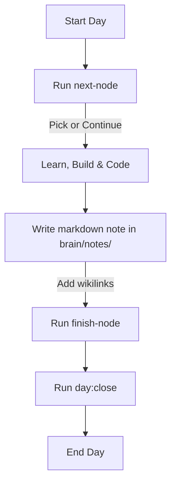

# VIZIER Daily Ritual & Runbook

This document is the operational heart of the VIZIER project. It defines the daily protocol, content pipeline, evolutionary logic, and non-negotiable rules for mastering AI engineering over the 251-day marathon.

---

## 1. THE DAILY LOOP (10 min overhead)

Every single day, follow this exact sequence to maintain momentum and sync state:



1. **Initialize the Day**:
   Run the selector tool to inspect active nodes and potential ghost nodes:
   ```bash
   npm run next-node
   ```
   * Choose to continue charging your active node, or select one of the top 3 ghost candidate nodes to start charging.
   * This automatically creates or opens the markdown note `brain/notes/<node-id>.md` populated with the required frontmatter and sections.

2. **Learn & Build**:
   * Research the topic against primary papers, specifications, or codebases.
   * Attempt a local script, prompt template, or integration within `agent-lab/`.
   * Keep the note open and document your findings, thoughts, and lessons. Drop double-bracket `[[wikilinks]]` as you discover connections.

3. **Verify & Complete**:
   When a charging node is thoroughly understood and validated:
   ```bash
   npm run finish-node
   ```
   * This changes the note status to `learned`, writes completion dates, and automatically locks the node's metadata locally in `curriculum/.locked/<node-id>.json`.
   * *Note: Multiple node finishes in one day are normal; zero finishes is also normal.*

4. **Close the Day**:
   **ALWAYS** run this command at the end of the day, even on charging-only days where zero nodes were finished:
   ```bash
   npm run day:close
   ```
   * This is the absolute heartbeat of the brain. It rebuilds the static files, increments the Day counter, commits the changes, and pushes to `main` on GitHub, triggering the public Vercel deploy.

---

## 2. THE CONTENT LOOP

The content loop handles sharing your journey with the world.

* **Draft Selection**: When a node is successfully lit (marked `learned`), a draft script creates a content brief. Select one of these generated drafts.
* **The 15-Minute Polish**: Spend exactly 15 minutes editing and polishing the chosen brief. Focus on clarity, citations, and removing fluff. Schedule it immediately.
* **The 1-in-4 Format Rule**: Keep your output dynamic by rotating through four content formats:
  1. **Carousel**: Slide decks explaining complex mechanisms step-by-step.
  2. **Text**: Deep-dive text posts containing code blocks and theoretical breakdowns.
  3. **Infographic**: High-fidelity architectural diagrams or flowcharts.
  4. **Video**: Quick walkthroughs or screenshares demonstrating a working prototype from `agent-lab/`.
* **Sunday Batch Session**: Use Sunday to review the week's notes, batch-generate posts for the upcoming week, and schedule the pipeline.

---

## 3. THE EVOLUTION LOOP

The curriculum graph is not static; it evolves with the AI engineering field and your learning pace.

* **Weekly Scan**:
  Every Sunday, run the scanning script to fetch latest updates:
  ```bash
  npm run frontier-scan
  ```
  * This scans the moving edge of the AI field (new model weights, API specs, agent protocols) to discover potential adjustments.
* **Replan Trigger**:
  Whenever a major release occurs, or you feel a cluster is too shallow or too deep:
  ```bash
  npm run replan
  ```
  * Explain what changed (e.g., "New reasoning model released, want to add a cluster on it").
  * The tool sends your request + ghost nodes + floating milestones to Gemini to output a proposed diff.
  * **Rule**: Replan only when the field or your pace demands it—never from restlessness alone.
* **Capstone Checkpoints**:
  Every capstone node in the curriculum includes a formal, mandatory replan checkpoint where you must assess your trajectory before proceeding to the next domain ring.

---

## 4. THE NON-NEGOTIABLE RULES

* **Show Up Daily**: The daily run of `npm run day:close` is the heartbeat of this project. Skipping days breaks the chain.
* **Charging Days Count**: A day spent struggling to understand a complex paper without lighting a node is a real, successful day. Do not rush or force completions.
* **Mandatory Feynman Explanation**: The Feynman explanation section ("Explain like I am 12") must be fully filled out and readable before running `npm run finish-node`.
* **Absolute Honesty**: Never backfill notes or dates dishonestly. The system is designed to show true progress.
* **VISION vs. LIVE**:
  * **VISION** mode (the preview graph) shares the dream—it shows the entire 251-day roadmap of where you are going.
  * **LIVE** mode (the default graph) shares the proof—it shows only the nodes you have actually lit and built.
